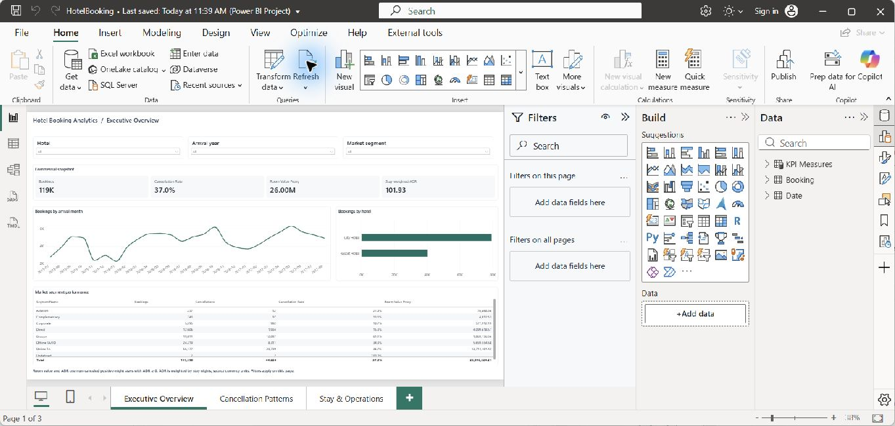

# Hotel Booking Analytics

A three-page Power BI report backed by Python validation and a relational SQL Server model.



> Current Power BI Desktop report. All three pages were refreshed, reviewed and saved; the [City Hotel filter](docs/qa/reviewed-city-filter-2026-11-05.png) recalculated weighted ADR to 106.50 CU.

## Business questions

- How do volume, cancellations, ADR and stay patterns differ by hotel, channel and market segment?
- Which operational patterns merit investigation, and which source issues could distort the interpretation?

All 119,390 source rows are retained. The dataset has no reliable booking/customer ID, so source row lineage is used and customer identity is not fabricated. The room-value proxy uses non-canceled bookings with positive stay nights and nonnegative ADR, and divides by exactly the same eligible nights for weighted ADR. `ADR × eligible stay nights` is labelled as a room-value proxy; the data does not support reliable occupancy, RevPAR or audited revenue.

## Review

- [Model](docs/model.md) · [KPI usefulness](docs/kpi_usefulness.md) · [Findings](docs/findings.md) · [Data quality](docs/data_quality.md) · [QA](docs/qa.md)
- [SQL model](sql/01_model.sql) · [Source reconciliation](sql/03_validate.sql)
- [PBIP](powerbi/HotelBookingPBIP/HotelBooking.pbip) · [Self-contained report generator](powerbi/build_pbip.py)

The report includes Executive Overview, Cancellation Patterns and Stay & Operations, with hotel/year/segment filters and a correctly grouped monthly trend. Cancellation comparisons are associations; some fields reflect later operational information.

## Rebuild

Download [Hotel Booking Demand](https://www.kaggle.com/datasets/jessemostipak/hotel-booking-demand) to `data/raw/hotel_bookings.csv`. Install Python dependencies and use the existing SQL Server Express instance with Microsoft `sqlcmd`/`bcp`.

```powershell
python -m pip install -r requirements.txt
& .\build_all.ps1 -PythonPath python
```

Database: `Portfolio_HotelBookings`. Open the PBIP in Power BI Desktop, check `DataRoot` in `definition/expressions.tmdl`, refresh and save. Rebuilding sets the parameter for the current checkout and recreates the report source. Raw data and caches are excluded.
