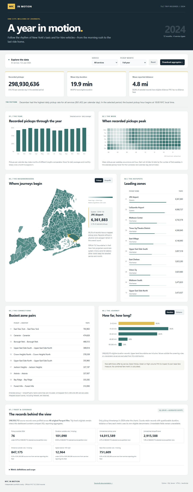

# NYC in Motion — TLC 2024

Streaming Python + SQL Server + custom JavaScript/geospatial analytics across **298,930,712 source records** from all 48 monthly TLC files.



> Current reviewed dashboard. All 65 filter states passed at 1,440 px desktop and 390 px mobile, including metric values, downloads and overflow checks. [Browser results](site/qa/browser-results-2026-11-04.json) · [Mobile preview](site/qa/reviewed-mobile.jpg)

**[Download/open the interactive dashboard](site/index.html).** Save the raw file as `.html` and open it in a browser. The approximately 1.5 MB standalone file works offline.

## What to explore

- Four service populations and twelve months, with 65 service/month combinations.
- Trips per calendar day, weekday/hour demand normalized by matching calendar days, pickup/dropoff maps for 263 zones, top directed routes and trip-length distributions.
- Three headline KPIs show recorded pickups, mean eligible trip duration and mean eligible reported distance. Quality profiles use field-eligible denominators, show FHV metrics as unavailable, and support filtered CSV downloads.

## Scale and model choices

The immutable Parquet files retain trip-level detail. Python profiles every row in bounded batches and retains source-file hashes. SQL Server Express stores file-traceable analytical aggregate facts with PK/FK relationships, rather than 299 million relational trip rows. The browser receives compact SQL reporting exports.

Exactly 76 pickups fall outside 2024; 298,930,636 records enter the year charts. Source/time/zone/route counts reconcile and SQL reruns do not duplicate data. Database data-file allocation was 136 MB at verification. FHV distance/fare remain unavailable, and differing service fare concepts are not combined into revenue.

## Review and rebuild

[Model and metrics](docs/model.md) · [Findings](docs/findings.md) · [QA](docs/qa.md) · [Pipeline](etl/prepare_analytics.py) · [Route ranking](etl/export_dashboard.ps1)

Acquire the [official 2024 TLC files and reference files](https://www.nyc.gov/site/tlc/about/tlc-trip-record-data.page). The downloader is in `etl/download_tlc_data.py`; the acquisition manifest pins the profiled bytes. Use service directories `yellow`, `green`, `fhv`, `hvfhv` and `reference` under the raw root. Install Python dependencies and use SQL Server Express with Microsoft `sqlcmd`/`bcp`.

```powershell
python -m pip install -r requirements.txt
& .\build_all.ps1 -PythonPath python -RawDir 'C:\Data\NYCTaxi\raw'
python .\tests\verify_data.py
```

Database: `Portfolio_NYCTaxi`. Source hashes are checked before checkpoint reuse. Raw Parquet and local source-path configuration are excluded. Map boundaries retain the official New York projected coordinate system; no artificial point coordinates are inferred.
