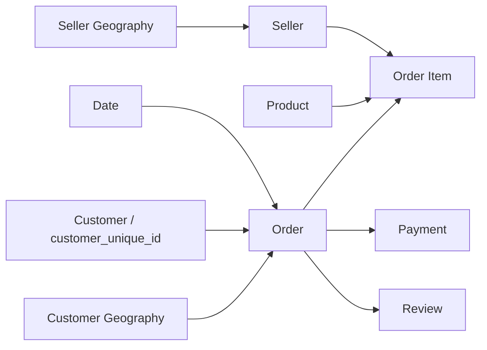

# Semantic model

Use Import mode for this dataset size. Keep every relationship single-direction from dimension to fact.

| From (1) | To (*) | Key | Active |
|---|---|---|---|
| Date | Order | DateKey → PurchaseDateKey | Yes |
| Customer | Order | CustomerKey | Yes |
| Customer Geography | Order | GeographyKey → CustomerGeographyKey | Yes |
| Order | Order Item | OrderKey | Yes |
| Order | Payment | OrderKey | Yes |
| Order | Review | OrderKey | Yes |
| Product | Order Item | ProductKey | Yes |
| Seller | Order Item | SellerKey | Yes |
| Seller Geography | Seller | GeographyKey | Yes |

`Cohort Retention`, `Metric Selector`, `Metric Fields`, `Top N`, and `Measures` remain disconnected. The cohort view is already aggregated by cohort/activity month in SQL.

Important grain decisions:

- `Customer` is one row per Olist `customer_unique_id`.
- `Order.OlistCustomerId` preserves the order-specific `customer_id` for traceability.
- Customer location is linked on each order because a real customer can place orders from different locations.
- `Order Item`, `Payment`, and `Review` retain their own grains; they are not flattened together, preventing many-to-many multiplication.
- Geography is referenced twice in Power Query to provide unambiguous customer and seller roles.

