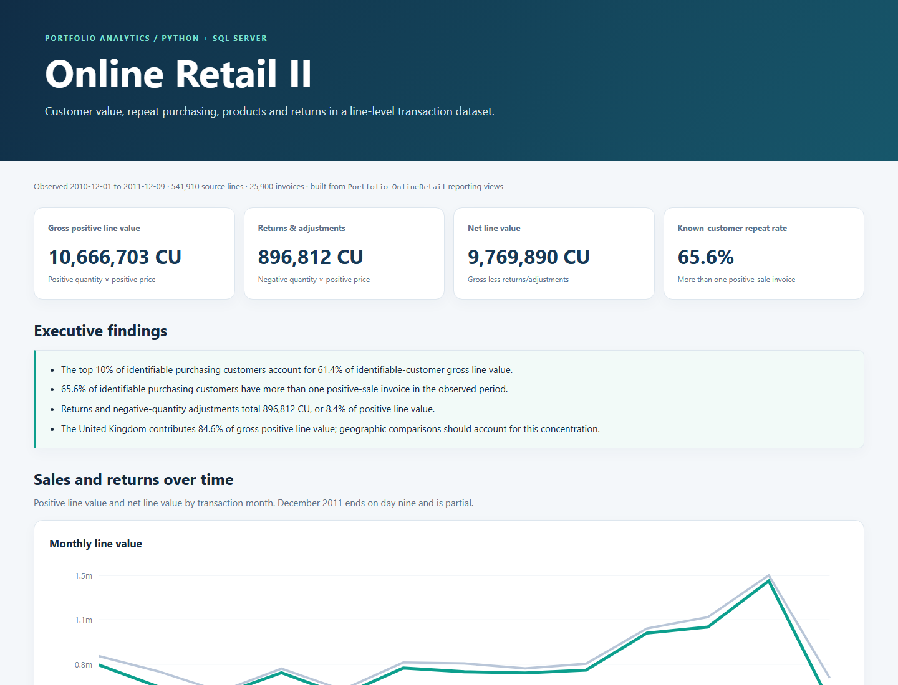

# Online Retail — Customer & Sales Intelligence

Python + SQL Server analysis of customer value, purchasing frequency, products and returns/adjustments.



**[Download/open the standalone report](report/online_retail_analysis.html).** GitHub displays HTML as source; download the raw file and open the saved `.html` in a browser. It has no external dependencies.

## Analytical work

- RFM segments, customer concentration and monthly purchase cohorts.
- Repeat purchasing with an equal 90-day observation window; stated Wilson reference intervals and censoring limits.
- Invoice-value skew, customer-ID coverage, product-label variability and return/adjustment treatment.
- All 541,910 source lines retained, including anonymous customers and fractional-cent prices; SQL verifies exact source/core amount reconciliation.

The downloaded Online Retail II archive contains an observed one-year file from December 2010 through December 9, 2011. The incomplete final month is excluded from retention comparisons. Transaction value is not presented as audited revenue or profit.

## Review and rebuild

[Model and definitions](docs/model.md) · [Findings](docs/findings.md) · [Data quality](docs/data_quality.md) · [QA](docs/qa.md) · [Python report](report/build_report.py)

Download [the original archive](https://www.kaggle.com/datasets/tunguz/online-retail-ii) and place `online_retail_II.csv` in `data/raw/`. Install Python dependencies; use SQL Server Express and Microsoft `sqlcmd`/`bcp`.

```powershell
python -m pip install -r requirements.txt
& .\build_all.ps1 -PythonPath python
```

Database: `Portfolio_OnlineRetail`. The report reads SQL reporting exports, never the raw CSV directly. Raw data and customer-level processed exports are excluded from this repository.
