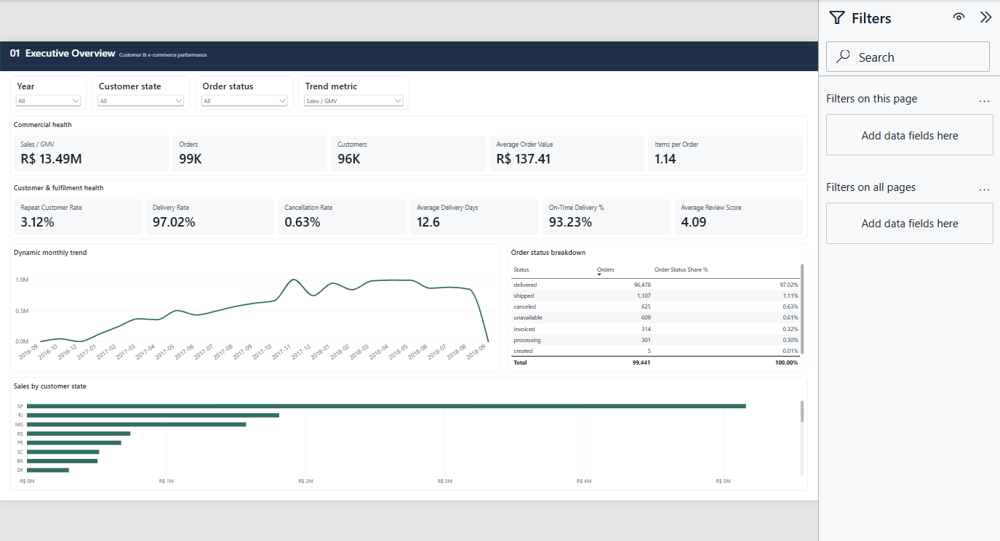

# Mikheil Gumberidze — Analytics & Data Applications

A starter portfolio of five projects covering **SQL Server, Python, Power BI, statistics, geospatial analytics, and React/.NET applications**. Each project connects a business or product question to a data model, a repeatable pipeline, and a report or application.

## Start here

| Project | What to look for | Review the result | Explore the implementation |
|---|---|---|---|
| **Olist E-Commerce** | Customer identity, cohorts/RFM, delivery analysis, star schema and 59 DAX measures | [Power BI preview](assets/olist-overview.png) | [Project guide](OlistEcommerce/README.md) · [SQL analysis](OlistEcommerce/sql/06_portfolio_analysis.sql) |
| **NYC in Motion** | Streaming 298.9M records into a compact SQL aggregate model; interactive zone mapping | [Dashboard preview](assets/taxi-dashboard.png) · [HTML dashboard](NYCTaxiAnalytics/site/index.html) | [Project guide](NYCTaxiAnalytics/README.md) · [Pipeline](NYCTaxiAnalytics/etl/prepare_analytics.py) |
| **Spotify Taste** | React/TypeScript UI, ASP.NET API, relational listening history, explainable preference scoring and discovery | [UI preview](assets/spotify-demo.png) · [Hosted read-only edition](https://spotify-taste-demo.pages.dev/) | [Application guide](SpotifyTastePrototype/README.md) · [Backend](SpotifyTastePrototype/backend) |
| **Hotel Booking Analytics** | Commercial KPIs, cancellation patterns, meaningful data-quality rules and a three-page Power BI report | [Power BI preview](assets/hotel-overview.png) | [Project guide](HotelBookingAnalytics/README.md) · [DAX/model](HotelBookingAnalytics/powerbi/HotelBookingPBIP/HotelBooking.SemanticModel/definition/tables) |
| **Online Retail** | Customer concentration, RFM, cohorts, equal-follow-up repeat analysis and statistical interpretation | [Report preview](assets/retail-overview.png) · [HTML report](OnlineRetailPython/report/online_retail_analysis.html) | [Project guide](OnlineRetailPython/README.md) · [Python analysis](OnlineRetailPython/report/build_report.py) |

## Skills demonstrated

- **SQL and modeling:** staging/core/reporting layers, appropriate grains, PK/FK relationships, indexes, window functions, grouping sets, reconciliation, and load audit trails.
- **Python and data engineering:** schema/type validation, repeatable imports, source hashing, bounded-memory Parquet processing, customer analysis, and generated analytical reports.
- **Power BI:** semantic models, DAX measures, cohorts, customer drill-through, dynamic metrics, filtering and documented KPI definitions.
- **Statistics and interpretation:** comparable follow-up windows, censoring, skewed-value distributions, model-based reference intervals, and explicit limits on causal conclusions.
- **Application development:** React, TypeScript, Vite, ASP.NET Core, EF Core, testable domain/application layers, interactive charts and accessible geospatial interfaces.

## View or run the work

**No setup needed for previews.** Open the images above to inspect the reports immediately. GitHub displays HTML as source: use **Download raw file**, save it as `.html`, then open it in a browser. The Taxi dashboard and Retail report are self-contained and work offline.

**Power BI:** open the `.pbip` projects in Power BI Desktop. Source datasets and caches are excluded, so acquire the public datasets and run the documented pipelines before refreshing. Change the `DataRoot` parameter to your local processed-export path.

**Spotify:** the included synthetic demo mode runs independently of SQL Server and private listening history. Follow its project README. The API-backed edition requires SQL Server and an authorized local export.

## Scope and verification

These are portfolio studies and application prototypes, not claims of paid client work or measured commercial impact. Project READMEs explain the data grain, metrics, verification and limitations. Raw datasets, personal Spotify exports/snapshots, credentials, dependencies and local runtime caches are excluded.

This is a starter release; reports and project material will be refined over time. See [REVIEW_GUIDE.md](REVIEW_GUIDE.md) for a quick code tour and [DATA_SOURCES.md](DATA_SOURCES.md) for attribution.

[GitHub profile](https://github.com/mishagumberidze-del)
