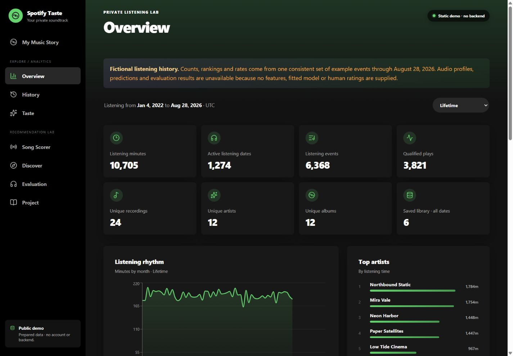

# Spotify Taste — Listening Analytics & Discovery

A React/TypeScript application backed by an ASP.NET Core API and SQL Server, combining listening analytics, explainable preference scoring and recording-aware discovery.



> Current fictional-event overview. Browser checks passed at 1,440 px desktop and 390 px mobile for the overview, last-30-day range, unavailable scorer and no page overflow. [Browser results](docs/qa/browser-results-2026-11-05.json) · [Mobile preview](docs/qa/reviewed-demo-mobile.jpg). This does not verify the separately hosted edition.

[Hosted read-only portfolio edition](https://spotify-taste-demo.pages.dev/) · The hosted edition uses a separately managed snapshot; this repository contains synthetic demo data, not that snapshot.

## What this demonstrates

- Layered domain/application/infrastructure/API design with EF Core and automated backend tests.
- Idempotent/auditable import of Extended Streaming History, source reconciliation and conservative track/recording identity.
- Interactive charts, yearly/lifetime stories, behavior and audio-feature coverage, and explainable preference signals.
- Diversified recommendations, recording-level exclusions, feedback/evaluation logic and recording-held-out validation.

Stack: **React 19, TypeScript, Vite, TanStack Query, Recharts, ASP.NET Core 8, EF Core, SQL Server and xUnit**.

## Run the synthetic demo

The demo derives its listening analytics from one coherent fictional event fixture. Fitted model results, recommendation scores, audio coverage, provider results and human evaluation are unavailable in this fixture; they are not fabricated. The reviewed source passed 149 backend tests and 23 frontend tests. Private streaming exports, liked-song snapshots, OAuth tokens and local settings are excluded.

```powershell
cd frontend/spotify-taste-web
npm ci
npm run build:demo
npm run preview -- --host 127.0.0.1
```

The included `.env.demo` selects synthetic demo mode. It needs no SQL Server, account access or enrichment API. Personal snapshot mode is retained in source but its private payload is not included.

## API-backed edition

Requires the .NET 8 SDK, Node.js and SQL Server. Set an appropriate local connection string for the `SpotifyTaste` database and import only an authorized export. The normal API defaults to read-only; maintenance/import functions require explicit local enablement as described in source.

```powershell
dotnet restore SpotifyTasteSolution.sln
dotnet test SpotifyTasteSolution.sln
dotnet run --project backend/SpotifyTaste.Api
```

The development frontend proxies `/api` to the local API; a normal frontend build remains API-backed. Database initialization and import depend on the chosen local edition/configuration, so a fresh clone does not contain populated listening data.

## Code tour

[KPI usefulness](docs/kpi_usefulness.md) · [Database relationships](docs/database-schema.md) · [Preference model and recommendations](docs/model-and-recommendations.md) · [Stories and evaluation](docs/music-story-and-evaluation.md)

[Domain](backend/SpotifyTaste.Domain) · [Application](backend/SpotifyTaste.Application) · [Infrastructure](backend/SpotifyTaste.Infrastructure) · [API](backend/SpotifyTaste.Api) · [Tests](backend/SpotifyTaste.Tests) · [React source](frontend/spotify-taste-web/src)
